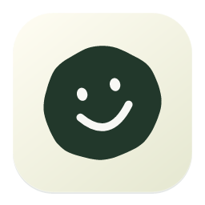
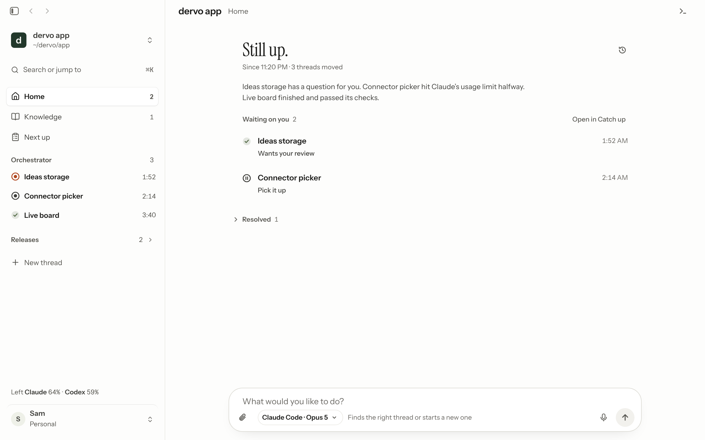
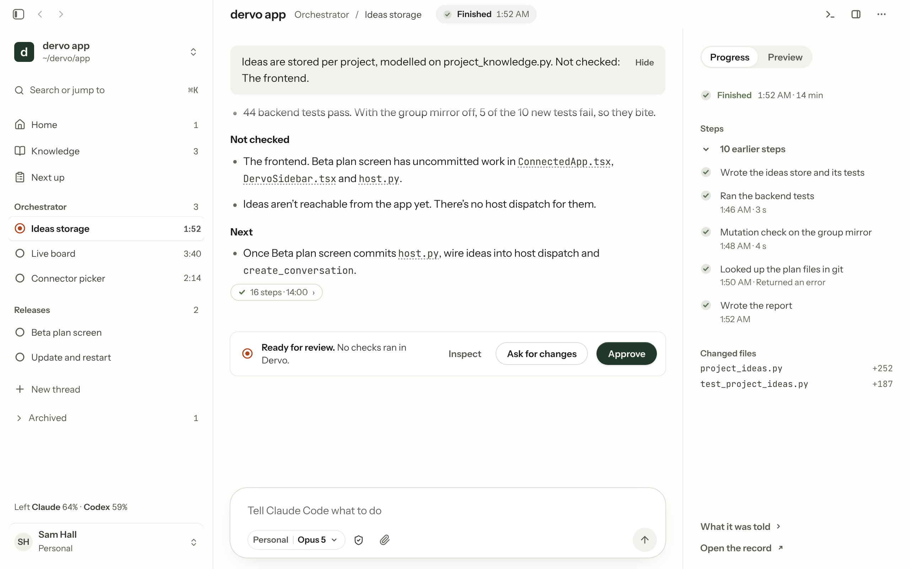

<div align="center">



# Dervo

**A desktop workspace for running Claude Code and Codex side by side, with a record of what each one did.**

[](LICENSE.md)


[What it does](#what-it-does) · [Get started](#getting-started) · [How it's built](#how-its-built) · [FAQ](#faq) · [Contributing](CONTRIBUTING.md)

</div>

<p align="center">
  <picture>
    <source media="(prefers-color-scheme: dark)" srcset="docs/images/home-dark.png">
    
  </picture>
</p>

<p align="center">
  <picture>
    <source media="(prefers-color-scheme: dark)" srcset="docs/images/thread-dark.png">
    
  </picture>
</p>

<p align="center"><sub>Screenshots use sample data.</sub></p>

Dervo runs the coding agents you already have, Claude Code and Codex, on your own machine and under your own logins. It
keeps track of what they did so you don't have to. Come back after a day away and Home tells you what moved, what
needs you and what finished.

> **Status: finished, no longer developed.** Dervo was a side project I built in September and October 2026. It went
> through a small private beta, and then I stopped working on it. I now use Claude Code's own projects for the same job,
> and they cover most of what Dervo set out to do. The code stays here to read, run and learn from. The Mac app is the
> most complete. The Windows and Linux builds are newer and have known test failures. I'm not planning more work,
> and issues and pull requests probably won't get a reply.

## Why Dervo

Coding agents are good at starting work and bad at telling you honestly what happened. Dervo sits above Claude Code and
Codex and keeps its own record of every run, so you can trust the summary instead of re-reading the transcript. It
doesn't replace your agents or host any compute. It runs the tools you already pay for.

## What it does

- **Home, one chat per project.** Ask in plain words. Home reads every thread, finds the right one or starts a new one,
  and splits a request into separate jobs by the files they touch.
- **Catch up.** "Since you left" lists what moved, what needs your review and what's stuck, with a per-project summary.
- **Threads that report honestly.** Every run ends with what changed, what was checked, what wasn't, and what's next.
  A run lost to a crash is reported as unconfirmed rather than silently continued.
- **Your accounts, not ours.** Dervo starts the published Claude Code and Codex tools with their own sign-ins. It
  never copies or proxies subscription tokens, and it checks the account and model before sending project content.
- **Auto-organisation.** Threads are named and filed into workstreams, follow-ups join the thread you had open, and
  your own filing always wins.
- **Knowledge and review.** Approved project knowledge persists across chats on both providers. Results wait for your
  review before they're accepted, and approving scope, accepting results and allowing installs are separate steps.
- **Git and worktrees.** Threads can work in their own git worktrees, and Dervo can commit, push and open pull requests
  when you ask.

## How it's built

Dervo is a [Tauri 2](https://tauri.app) app with three layers:

| Layer | Where | What it does |
|---|---|---|
| Native shell | [`src/`](src) (Rust) | Windows, menus, Keychain, folder pickers, the Dock tile and the bridge to the host |
| Host | [`backend/`](backend) (Python 3.13) | Projects, threads, runs, knowledge and the adapters that drive Claude Code and Codex |
| Interface | [`frontend/`](frontend) (React, TypeScript, Vite) | Every screen; `frontend/src/local` holds Dervo's own app screens |

The Rust bridge ([`src/bridge.rs`](src/bridge.rs)) starts the Python host and passes operations between it and the
interface. Provider-specific code lives in `backend/claude_*.py`, `backend/codex_*.py` and the
[`backend/dervo_harness`](backend/dervo_harness) package. [`supabase/`](supabase) holds the schema for the optional
beta account service.

## Getting started

### Requirements

- macOS 11 or later. Windows and Linux builds are newer; see [`.github/workflows/windows.yml`](.github/workflows/windows.yml) and [`.github/workflows/linux.yml`](.github/workflows/linux.yml)
- [Rust](https://rustup.rs) (stable), [Node.js](https://nodejs.org) 22 and [pnpm](https://pnpm.io)
- Python 3.13
- [Claude Code](https://docs.anthropic.com/en/docs/claude-code) and/or [Codex](https://github.com/openai/codex),
  installed and signed in

### Run from source

```sh
git clone https://github.com/brambach/dervo.git
cd dervo
(cd frontend && pnpm install)
node frontend/node_modules/vite/bin/vite.js build frontend --outDir ../dist
node frontend/node_modules/@tauri-apps/cli/tauri.js dev
```

The Tauri shell serves the interface from `dist/`, so rebuild it after changing the frontend.

### Build and test

[`build.sh`](build.sh) runs the backend, frontend and Rust tests, builds the interface and bundles an ad hoc signed
`Dervo Local.app` under `target/`:

```sh
./build.sh
```

To run the test suites on their own:

```sh
(cd backend && python3 -m unittest)          # host
(cd frontend && pnpm test && pnpm typecheck)  # interface
cargo test                                    # native shell
```

`DERVO_NODE`, `DERVO_CARGO` and `DERVO_PYTHON` point the build at specific executables. The header of `build.sh`
explains each one.

### Accounts

Dervo has no Dervo account. It uses the Claude Code and Codex sign-ins you already have. The private beta's Supabase
account service is still in the source (`supabase/`, `backend/supabase_*.py`) but a source build doesn't ship its
config (`runtime/dervo-account-public.json`), so it starts without a sign-in gate.

## Project layout

```text
backend/     Python host, provider adapters and their unit tests
frontend/    React interface, Playwright end-to-end tests
src/         Rust/Tauri shell
runtime/     Pinned runtime manifests and third-party notices bundled into the app
schemas/     Codex app-server protocol schema the Codex adapter is checked against
scripts/     Build, release and diagnostic scripts
supabase/    Beta account service: migrations, edge functions, email templates
tools/       Load tests, evals and the release signer
docs/        Release procedure and images
```

## FAQ

**Does Dervo send my code anywhere?** Dervo runs on your machine and starts Claude Code and Codex locally. Project
content goes only to the provider whose tool you chose to run, under your own sign-in. Optional features (the voice
model download, an OpenRouter connection) make their own network calls when you turn them on. The usage and error
reports from the private beta belong to its account service, which a source build doesn't include.

**Does it need an API key or a Dervo account?** No. It uses the Claude Code and Codex sign-ins you already have.

**Does it use my subscription for me?** It starts the published tools, which use your plan as they normally do. Dervo
never copies or proxies your tokens.

**Can I use only one of Claude Code or Codex?** Yes. Either works on its own.

**How is this different from running the agents in a terminal?** Terminals show you output. Dervo files threads by
project, tracks what changed and what was checked, and tells you what needs a decision when you come back.

More detail on the design is in [docs/ARCHITECTURE.md](docs/ARCHITECTURE.md).

## Contributing

Dervo isn't being developed any more, so pull requests probably won't be reviewed. You're welcome to fork it under
the license below. [CONTRIBUTING.md](CONTRIBUTING.md) still describes how the code was worked on. Please report
security issues privately, as described in [SECURITY.md](SECURITY.md).

## License

Dervo is released under the [Functional Source License, version 1.1, with an Apache 2.0 future license](LICENSE.md). You can read, run, change and contribute to it for any purpose except selling a competing product, and each version becomes Apache 2.0 two years after its release.

The interface started from [Buzz](LICENSE-Buzz) by Block, Inc., licensed under Apache 2.0. Bundled fonts, runtimes and
other third-party components keep their own licenses, listed in [`runtime/`](runtime) and
[`backend/dervo_harness/THIRD_PARTY_NOTICES.md`](backend/dervo_harness/THIRD_PARTY_NOTICES.md).

Claude and Claude Code are trademarks of Anthropic. Codex is a trademark of OpenAI. Dervo isn't affiliated with or
endorsed by either.
